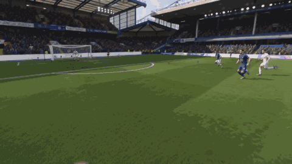
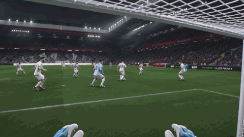
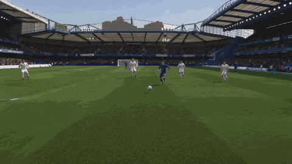
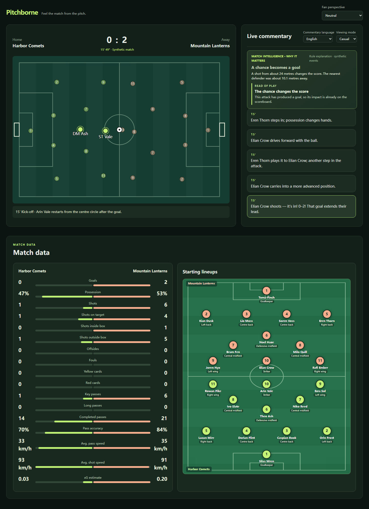
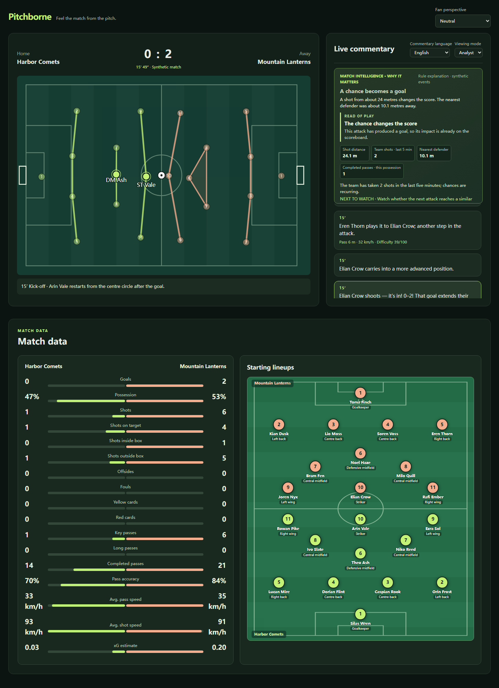

# Pitchborne ⚽


### What if a live football highlight let you step onto the pitch?

**Watch the match. Read the game. Feel the moment.** Pitchborne plays a fictional 90-minute match as a live 11-v-11 animation with running commentary. When a shot is on target, it can turn the event into a short AI-generated **striker or goalkeeper POV**. The match keeps moving while the video is made.

### Three moments, three ways to be there

These short previews play directly in the README. Click one for the full-resolution MP4:

| Score the goal | Face the goal | Have your shot saved |
| :---: | :---: | :---: |
| [](asserts/goal.mp4) | [](asserts/goal2.mp4) | [](asserts/save2.mp4) |
| [Full video: goal](asserts/goal.mp4) | [Full video: goalkeeper POV](asserts/goal2.mp4) | [Full video: saved shot](asserts/save2.mp4) |

These are example generated clips. During a live run, Pitchborne requests new clips from the selected match events rather than playing these three files.

### The broadcast



Switch to **Analyst** mode to see dynamic formation lines and the evidence behind an insight:

<details>
<summary>See the analyst view</summary>



</details>

Pick a side—**home fan**, **away fan**, or **neutral**—and the commentary and preferred POV change with you. English, Chinese, Spanish, and French commentary tracks are available. The live data board follows only what has happened so far: score, shots, possession estimate, passing, xG estimate, and more.

## Try it locally

Requires Python 3.10+ and Node.js 22+. From the repository root:

```powershell
python -m pip install -r requirements.txt
npm ci
python -m workflow.server
```

Open <http://127.0.0.1:8000>. The default match uses deterministic seed `7` and starts automatically. The animation, commentary, and data board work without an API key.

For live AI insight writing and POV video generation, copy `.env.example` to `.env`, then set `OPENROUTER_API_KEY`:

```powershell
Copy-Item .env.example .env
```

The example configuration uses `deepseek/deepseek-v4.1-flash-1017` for text and `bytedance/seedance-2.0-mini` for video. Keep `.env` private; it is git-ignored. Video requests use a paid provider and can finish after the triggering moment. Pitchborne keeps the match and text moving, then offers the clip when it is ready.

Want a different match? Restart with another seed:

```powershell
python -m workflow.server --seed 42
```

To generate the data without launching the UI, run `python -m scripts.generate_match --seed 42`. The generated match, events, clips, and language tracks are written under `data/matches/seed-<seed>/`.

For a hosted demo, see the [Azure Container Apps deployment guide](docs/azure-deploy.md).

## Behind the scenes

Pitchborne follows one event-to-experience pipeline:

| Stage | What happens |
| --- | --- |
| **Ingest** | A deterministic simulator supplies synthetic match metadata, passes, carries, pressure, tackles, possession changes, shots, and saves. |
| **Interpret** | The event stream updates score, shot and passing counts, possession and xG estimates, and short-term patterns using only events already seen. |
| **Explain** | Commentary and insight cards say why a chance matters, including pressure, recent opportunities, and match rhythm. |
| **Render** | A synchronized pitch, live commentary feed, insight card, and match data board present the story on screen. |
| **Personalize** | Team allegiance, casual/analyst modes, and four commentary languages change the experience; on-target shots can become striker or goalkeeper POV. |

The server prepares the synthetic event stream and localized commentary at launch. The browser plays it on a compressed timeline. POV jobs run asynchronously, with at most two upcoming shots on target being prepared at once. A ready clip pauses the pitch for playback and then resumes it; a late clip does not pause the match while it generates.

The main pieces are `scripts/generate_match.py` for match data, `workflow/match_commentary.py` and `workflow/broadcast_beats.py` for commentary, `workflow/insights.py` for interpretation, `workflow/openrouter_video.py` for video jobs, `workflow/server.py` for the local API, and `web/` for the broadcast UI.

### What is simulated

All teams, players, and events are fictional. The event layout takes inspiration from [StatsBomb Open Data](https://github.com/hudl/open-data), but it is a smaller custom schema, not a drop-in StatsBomb export. [pl-insights-engine](https://github.com/timmytrace/pl-insights-engine) informed the kind of football context worth showing; Pitchborne uses its own data and implementation.

Player motion is interpolated from synthetic event keyframes, not optical tracking. Possession, xG, and ball/shot speeds are simulator estimates. Unmodelled events such as offsides and cards display zero. Commentary is on-screen text; text-to-speech and real broadcast-video understanding are outside this prototype. The optional auto-event demo works only on this project's rendered synthetic footage.

## Verify

```powershell
npm test
python -m unittest discover -s tests -p 'test_*.py'
```

For the optional synthetic-video event detection demo, install `requirements-video.txt` and run `python -m scripts.auto_event_demo`.
